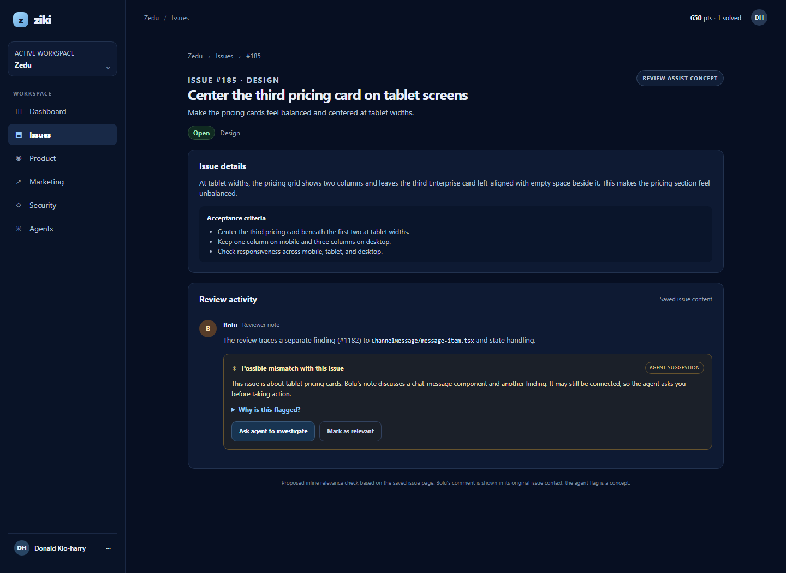

# Ziki review comment relevance concept

This static prototype demonstrates an inline review-comment relevance check on issue #185. It places the task, Bolu's reviewer note, the agent's possible-mismatch explanation, and the human's choices together on the issue page.

The agent flag is a proposed interaction concept, not an existing Ziki feature. The page is served from `index.html` and can be deployed to Vercel as a static site.

## Preview

